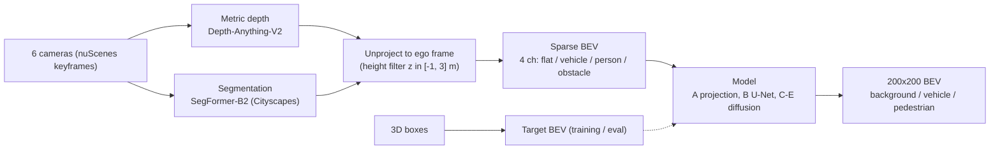
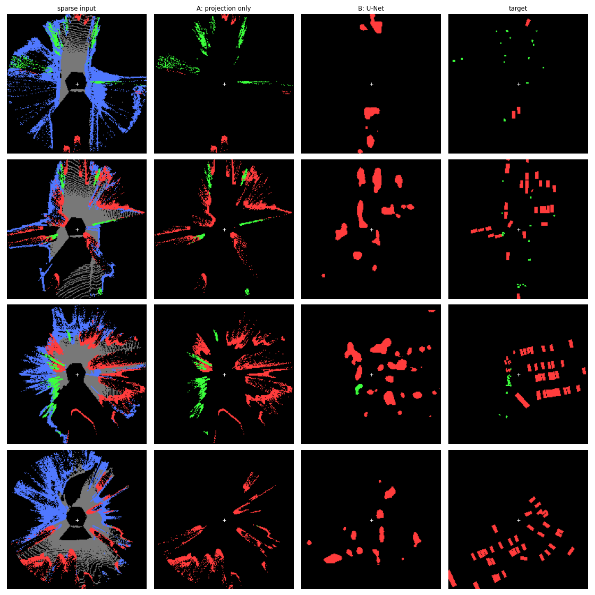
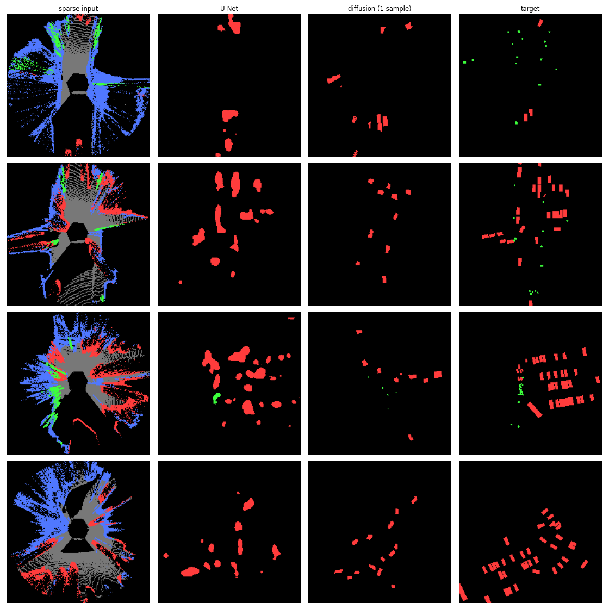
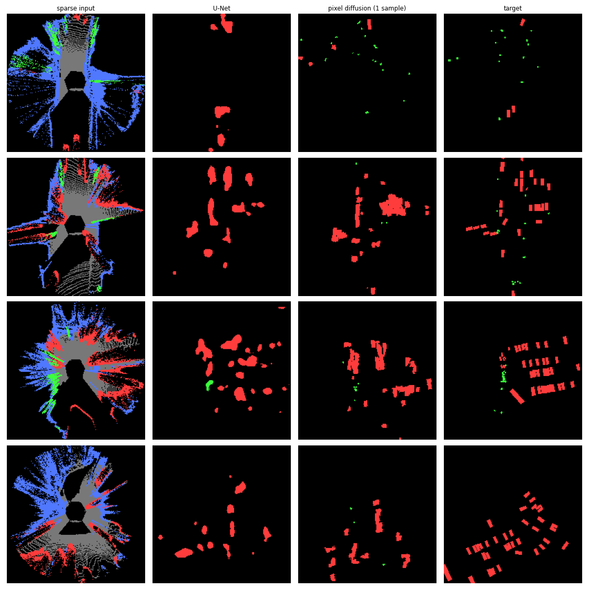
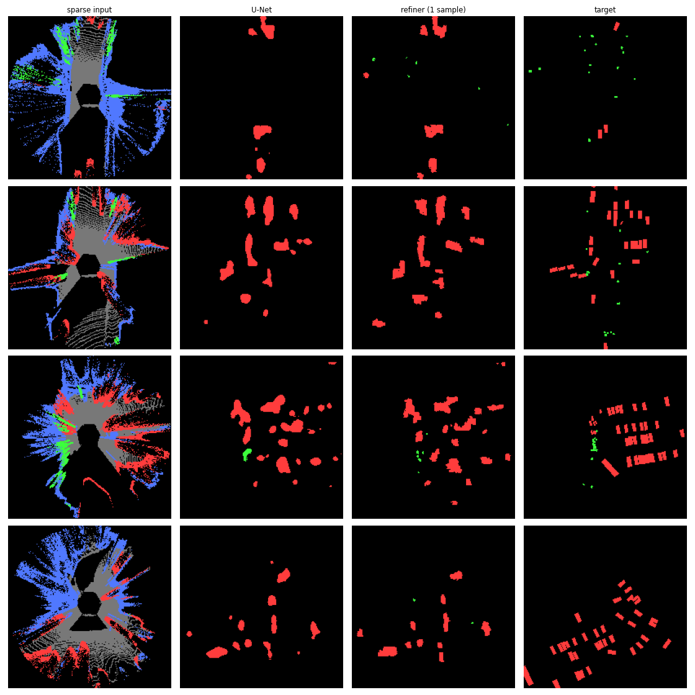
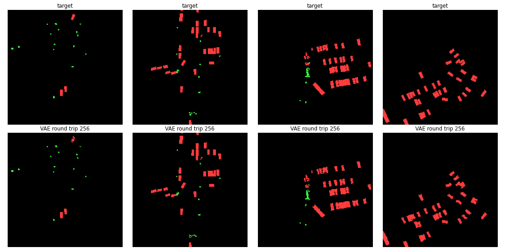

# Dreaming of Birds

Predict the full bird's-eye-view (BEV) map (drivable area, pedestrian crossings, walkways, lane dividers, vehicles, pedestrians) from the 6 surround cameras of a nuScenes car, and test whether diffusion models can "dream" the dense map from sparse, noisy projected evidence.

Short answer (nuScenes trainval, 10.6k training frames): a diffusion transformer that cross-attends to the camera images (hybrid DiT) reaches test mIoU **0.319** vs **0.260** for a U-Net. It wins on road layout (map mIoU 0.422 vs 0.316) and loses on objects (0.114 vs 0.148). On nuScenes-mini (282 frames) every diffusion model lost to the U-Net. Full log: [EXPERIMENTS.md](EXPERIMENTS.md).

## Results (v2: full BEV, nuScenes trainval)

Test = official nuScenes val scenes (1,982 frames). Model selection on a held-out 8% of train scenes (919 frames); train 10,628 frames. Per-layer IoU at threshold 0.5, single seed.

| Method | drivable | ped crossing | walkway | divider | vehicle | pedestrian | map mIoU | obj mIoU | mIoU |
|---|---|---|---|---|---|---|---|---|---|
| A: projection only | 0.204 | 0.000 | 0.075 | 0.000 | 0.059 | 0.005 | 0.070 | 0.032 | 0.057 |
| B: U-Net (1.9M) | 0.591 | 0.155 | 0.302 | 0.218 | **0.232** | **0.064** | 0.316 | **0.148** | 0.260 |
| D: pixel diffusion (4-sample mean) | 0.528 | 0.063 | 0.188 | 0.109 | 0.161 | 0.015 | 0.222 | 0.088 | 0.177 |
| F: hybrid DiT (1 sample) | 0.672 | 0.334 | 0.377 | 0.250 | 0.189 | 0.035 | 0.408 | 0.112 | 0.310 |
| F: hybrid DiT (4-sample mean) | **0.690** | **0.341** | **0.401** | **0.256** | 0.203 | 0.025 | **0.422** | 0.114 | **0.319** |


Colours: dark grey = drivable, white = crossing, green = walkway, yellow = divider, red = vehicle, bright green = pedestrian. The DiT draws intersections and crossings that the sparse input barely shows; its cars are crisp boxes, but misplaced ones cost more IoU than the U-Net's blobs.

**F: hybrid DiT** (`models/dit.py`, 45.6M params): BEV tokens = 8x8 patches of [noisy map, sparse BEV] (625 tokens). Each of 12 blocks does self-attention over BEV tokens, then cross-attention to 672 camera tokens (frozen DINOv2-small patch features + an MLP of each patch's ray in the ego frame (PETR-style) + a camera-id embedding), then an MLP, all modulated by the timestep (adaLN-Zero). Predicts the clean map's logits; sampled with 20-step DDIM.

The v1 sections below (objects only, nuScenes-mini) are kept as the history of how I got here.

## Pipeline



## Geometry

- Pixel (u, v) with depth d unprojects through the camera intrinsics K: `p_cam = d * K^-1 [u, v, 1]^T`, then the camera-to-ego calibration (4x4) moves it into the ego frame (single keyframe; the few-ms camera/lidar timestamp offset is ignored). Target boxes are moved into the same ego frame with the LIDAR_TOP ego pose.
- Ego frame: x forward, y left, z up. BEV image: row 0 is the far-forward edge, col 0 is the left edge, so forward points up.
- `row = (x_max - x) / res`, `col = (y_max - y) / res`; 200x200 cells, 0.5 m/cell, +-50 m, ego at the centre.
- Targets are rasterised from 3D boxes (boxes with 0 lidar+radar points are skipped).

## Models

| ID | Model | One line |
|---|---|---|
| A / A+ | Projection only | Label a cell by any projected point of that class (A+ adds 3x3 dilation). |
| B | U-Net | 1.9M-param, 4 levels (32-64-128-256), weighted CE + soft Dice, trained on the sparse BEV. |
| C | SD1.5 + ControlNet | Frozen Stable Diffusion 1.5 VAE/UNet, trainable ControlNet (361M) on the sparse BEV; map painted as a 3-colour image. |
| D | Pixel diffusion | From-scratch conditional diffusion (cosine schedule, DDIM 20 steps); same U-Net backbone as B (2.05M params), input = noisy map + sparse BEV, predicts x0 logits. |
| E | Diffusion refiner on B | D plus B's softmax probabilities as 3 extra input channels (frozen B). |

## v1 results (vehicles + pedestrians only, nuScenes-mini)

Test = nuScenes-mini `mini_val` (81 frames, scene-0103 and scene-0916). Model selection on held-out scene-0655; train 282 / val 41 / test 81 frames. mIoU = mean of vehicle and pedestrian IoU. Single seed.

| Method | Vehicle IoU | Pedestrian IoU | mIoU |
|---|---|---|---|
| A: projection only | 0.096 | 0.004 | 0.050 |
| A+: projection + 3x3 dilation | 0.097 | 0.004 | 0.051 |
| B: U-Net | 0.151 | 0.041 | 0.096 |
| C: diffusion (1 sample) | 0.037 | 0.001 | 0.019 |
| C: diffusion (4-sample vote) | 0.003 | 0.000 | 0.001 |
| D: pixel diffusion (1 sample) | 0.117 | 0.007 | 0.062 |
| D: pixel diffusion (4-sample mean) | 0.129 | 0.002 | 0.066 |
| E: diffusion refiner on U-Net (1 sample) | 0.136 | 0.015 | 0.076 |
| E: diffusion refiner on U-Net (4-sample mean) | 0.141 | 0.013 | 0.077 |

Differences of about 0.01 are within the noise of 81 test frames and one seed.

**Sparse input / projection (A) / U-Net (B) / target**


**SD1.5 + ControlNet (C)**


**Pixel diffusion (D)**


**Refiner (E)**


**VAE round-trip ceiling for C** (target -> SD VAE -> snap, no diffusion): test vehicle 0.932 / pedestrian 0.736 at 256 px.


## What I learned

- **Monocular depth smears objects along camera rays.** Projection alone gives streaks, not boxes (A: mIoU 0.050) and dilation does not help.
- **ControlNet memorised instead of learning geometry.** C produced crisp, realistic car boxes in the wrong places. A one-step x0 probe gave vehicle IoU 0.49 on train frames vs 0.002 on test, with 361M parameters on 282 frames.
- **Stable Diffusion's schedule has non-zero terminal SNR.** It keeps ~7% of the clean latent at t=T, so DDIM from pure noise gave garbage even on train frames; starting from the blank-map latent noised to the first step fixed sampling.
- **Controlled comparison B vs D:** same backbone, same loss, same data; the diffusion objective alone gave no gain (mIoU 0.062 vs 0.096). Most training steps sit at low/mid noise where the noisy map leaks the answer.
- **Strict per-cell IoU rewards hedged blobs over sharp misplaced boxes.** D's rectangular boxes score below B's blurry-but-centred blobs.
- **Data is the bottleneck.** B scores mIoU 0.275 on its training frames vs 0.096 on test; the refiner (E) inherits this mismatch and learns to over-trust B (0.077 vs B's 0.096).

## Scaling up

v2 uses ~13.5k keyframes from nuScenes trainval camera blobs 01-04 (340 scenes), selected with `dataset: trainval` in `config.yaml`; results at the top. With 38x more data the U-Net's vehicle IoU went from 0.151 to 0.232, and the pixel diffusion model (D) still trails it, so the E4 conclusion holds. The transformer with direct camera access (F) is what finally beats it. All v2 steps run in order with `./run_v2_pipeline.sh` (logs RAM/disk per step to `logs/`).

## Reproduce

```bash
pip install -r requirements.txt      # also needs a CUDA GPU; depth+seg run in fp16 (~2 GB VRAM)
```

Data (put under `~/datasets/`, paths are set in `config.yaml`):
- Mini (~4 GB): `wget https://www.nuscenes.org/data/v1.0-mini.tgz`, extract to `~/datasets/nuscenes` (`sweeps/` not needed).
- Trainval: from https://www.nuscenes.org/nuscenes#download (free account) get `v1.0-trainval_meta.tgz` plus `v1.0-trainval0{1..4}_blobs_camera.tgz`; extract the meta and only `samples/` from each blob to `~/datasets/nuscenes_trainval` (`tar -xzf <blob> --wildcards 'samples/*'`).

Select the dataset with `dataset: mini` or `dataset: trainval` in `config.yaml`; caches go to `~/datasets/bev_cache_v2` / `bev_cache_trainval_v2`. Map targets need the nuScenes map expansion v1.3 extracted into the dataroot's `maps/`.

```bash
python prepare_data.py                       # depth + seg -> 6-ch sparse BEV + box layers
python make_map_targets.py                   # adds map layers -> 6-layer target (CPU)
python train.py                              # B: U-Net
python train_pixel_diffusion.py              # D: pixel diffusion
python extract_image_features.py             # frozen DINOv2 camera tokens for F
python train_dit.py                          # F: hybrid DiT
python evaluate.py                           # test metrics + qualitative figure in results/v2/
python visualize_sample.py <sample_token> out.png   # 6 cameras + sparse + target
```

## Repo layout

- `config.yaml` - all paths and hyperparameters, dataset switch
- `bev_geometry.py` - BEV convention, projection and rasterisation helpers
- `prepare_data.py` - runs depth + segmentation, builds the sparse/target BEV cache
- `dataset.py` - cached BEV dataset, mini/trainval split logic
- `models/unet.py` - U-Net (B) and timestep embedding
- `models/dit.py` - hybrid DiT with camera cross-attention (F)
- `models/pixel_diffusion.py` - schedule, loss and DDIM sampler (shared by D and F)
- `train.py`, `train_pixel_diffusion.py`, `train_dit.py` - training scripts for B, D, F
- `make_map_targets.py` - map-expansion layers into the target; `extract_image_features.py` - DINOv2 camera tokens
- `run_v2_pipeline.sh` - runs every v2 step in order with RAM/disk logging
- `evaluate.py`, `metrics.py` - evaluation and IoU from confusion matrices
- `visualize_sample.py`, `viz.py` - plotting helpers
- `results/v2/` - v2 results table and figure; `results/*` - v1 (mini) history. C/E code (SD ControlNet, refiner) is in git history at b5afca6
- `EXPERIMENTS.md` - full experiment log (E0-E9)
