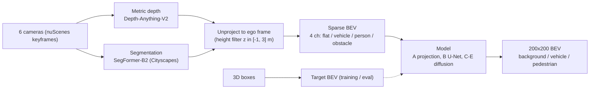

# Dreaming of Birds

Predict a bird's-eye-view (BEV) map of vehicles and pedestrians from the 6 surround cameras of a nuScenes car, and test whether diffusion models can "dream" the dense map from sparse, noisy projected evidence.

Short answer so far (nuScenes-mini, 282 training frames): a small U-Net beats every diffusion variant I tried, and the main bottleneck is data, not the model. Full log: [EXPERIMENTS.md](EXPERIMENTS.md).

## Pipeline



## Geometry

- Pixel (u, v) with depth d unprojects through the camera intrinsics K: `p_cam = d * K^-1 [u, v, 1]^T`, then the camera-to-ego calibration (4x4) moves it into the ego frame (single keyframe; the few-ms camera/lidar timestamp offset is ignored). Target boxes are moved into the same ego frame with the LIDAR_TOP ego pose.
- Ego frame: x forward, y left, z up. BEV image: row 0 is the far-forward edge, col 0 is the left edge, so forward points up.
- `row = (x_max - x) / res`, `col = (y_max - y) / res`; 200x200 cells, 0.5 m/cell, +-50 m, ego at the centre.
- Targets are rasterised from 3D boxes (boxes with 0 lidar+radar points are skipped).

## Models

| ID | Model | One line |
|---|---|---|
| A / A+ | Projection only | Label a cell by any projected point of that class (A+ adds 3x3 dilation). |
| B | U-Net | 1.9M-param, 4 levels (32-64-128-256), weighted CE + soft Dice, trained on the sparse BEV. |
| C | SD1.5 + ControlNet | Frozen Stable Diffusion 1.5 VAE/UNet, trainable ControlNet (361M) on the sparse BEV; map painted as a 3-colour image. |
| D | Pixel diffusion | From-scratch conditional diffusion (cosine schedule, DDIM 20 steps); same U-Net backbone as B (2.05M params), input = noisy map + sparse BEV, predicts x0 logits. |
| E | Diffusion refiner on B | D plus B's softmax probabilities as 3 extra input channels (frozen B). |

## Results

Test = nuScenes-mini `mini_val` (81 frames, scene-0103 and scene-0916). Model selection on held-out scene-0655; train 282 / val 41 / test 81 frames. mIoU = mean of vehicle and pedestrian IoU. Single seed.

| Method | Vehicle IoU | Pedestrian IoU | mIoU |
|---|---|---|---|
| A: projection only | 0.096 | 0.004 | 0.050 |
| A+: projection + 3x3 dilation | 0.097 | 0.004 | 0.051 |
| B: U-Net | 0.151 | 0.041 | 0.096 |
| C: diffusion (1 sample) | 0.037 | 0.001 | 0.019 |
| C: diffusion (4-sample vote) | 0.003 | 0.000 | 0.001 |
| D: pixel diffusion (1 sample) | 0.117 | 0.007 | 0.062 |
| D: pixel diffusion (4-sample mean) | 0.129 | 0.002 | 0.066 |
| E: diffusion refiner on U-Net (1 sample) | 0.136 | 0.015 | 0.076 |
| E: diffusion refiner on U-Net (4-sample mean) | 0.141 | 0.013 | 0.077 |

Differences of about 0.01 are within the noise of 81 test frames and one seed.

**Sparse input / projection (A) / U-Net (B) / target**


**SD1.5 + ControlNet (C)**


**Pixel diffusion (D)**


**Refiner (E)**


**VAE round-trip ceiling for C** (target -> SD VAE -> snap, no diffusion): test vehicle 0.932 / pedestrian 0.736 at 256 px.


## What I learned

- **Monocular depth smears objects along camera rays.** Projection alone gives streaks, not boxes (A: mIoU 0.050) and dilation does not help.
- **ControlNet memorised instead of learning geometry.** C produced crisp, realistic car boxes in the wrong places. A one-step x0 probe gave vehicle IoU 0.49 on train frames vs 0.002 on test, with 361M parameters on 282 frames.
- **Stable Diffusion's schedule has non-zero terminal SNR.** It keeps ~7% of the clean latent at t=T, so DDIM from pure noise gave garbage even on train frames; starting from the blank-map latent noised to the first step fixed sampling.
- **Controlled comparison B vs D:** same backbone, same loss, same data; the diffusion objective alone gave no gain (mIoU 0.062 vs 0.096). Most training steps sit at low/mid noise where the noisy map leaks the answer.
- **Strict per-cell IoU rewards hedged blobs over sharp misplaced boxes.** D's rectangular boxes score below B's blurry-but-centred blobs.
- **Data is the bottleneck.** B scores mIoU 0.275 on its training frames vs 0.096 on test; the refiner (E) inherits this mismatch and learns to over-trust B (0.077 vs B's 0.096).

## Scaling up

Currently re-running the pipeline on ~13.5k frames from nuScenes trainval camera blobs 01-04 (340 scenes), selected with `dataset: trainval` in `config.yaml`. Results: TBD.

## Reproduce

```bash
pip install -r requirements.txt      # also needs a CUDA GPU; depth+seg run in fp16 (~2 GB VRAM)
```

Data (put under `~/datasets/`, paths are set in `config.yaml`):
- Mini (~4 GB): `wget https://www.nuscenes.org/data/v1.0-mini.tgz`, extract to `~/datasets/nuscenes` (`sweeps/` not needed).
- Trainval: from https://www.nuscenes.org/nuscenes#download (free account) get `v1.0-trainval_meta.tgz` plus `v1.0-trainval0{1..4}_blobs_camera.tgz`; extract the meta and only `samples/` from each blob to `~/datasets/nuscenes_trainval` (`tar -xzf <blob> --wildcards 'samples/*'`).

Select the dataset with `dataset: mini` or `dataset: trainval` in `config.yaml`; caches go to `~/datasets/bev_cache` / `bev_cache_trainval`.

```bash
python prepare_data.py                       # depth + seg -> sparse BEV and target BEV cache
python train.py                              # B: U-Net (checkpoints/unet)
python train_pixel_diffusion.py              # D: pixel diffusion
python train_pixel_diffusion.py --refiner    # E: refiner (needs B's checkpoint)
python train_diffusion.py                    # C: SD1.5 + ControlNet (downloads SD1.5, ~9 GB VRAM)
python check_vae.py                          # VAE round-trip ceiling for C
python evaluate.py                           # test-split metrics + qualitative figures in results/
python visualize_sample.py <sample_token> out.png   # 6 cameras + sparse + target
```

## Repo layout

- `config.yaml` - all paths and hyperparameters, dataset switch
- `bev_geometry.py` - BEV convention, projection and rasterisation helpers
- `prepare_data.py` - runs depth + segmentation, builds the sparse/target BEV cache
- `dataset.py` - cached BEV dataset, mini/trainval split logic
- `models/unet.py` - U-Net (B) and timestep embedding
- `models/diffusion.py` - SD1.5 + ControlNet wrapper (C)
- `models/pixel_diffusion.py` - schedule, loss and DDIM sampler for D/E
- `train.py`, `train_diffusion.py`, `train_pixel_diffusion.py` - training scripts for B, C, D/E
- `evaluate.py`, `metrics.py` - evaluation and IoU from confusion matrices
- `check_vae.py` - VAE ceiling gate for C
- `visualize_sample.py`, `viz.py` - plotting helpers
- `results/` - results table and figures
- `EXPERIMENTS.md` - full experiment log (E0-E5)
