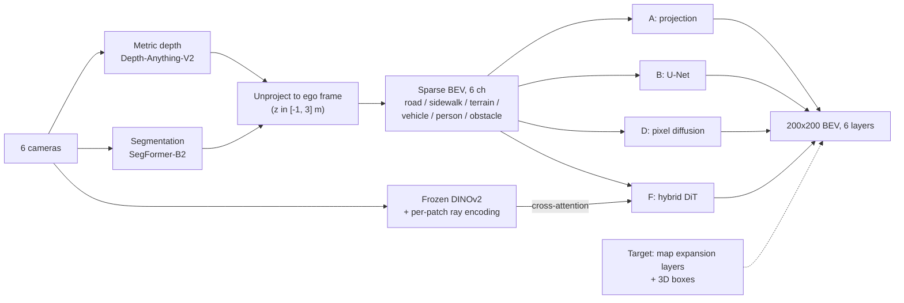
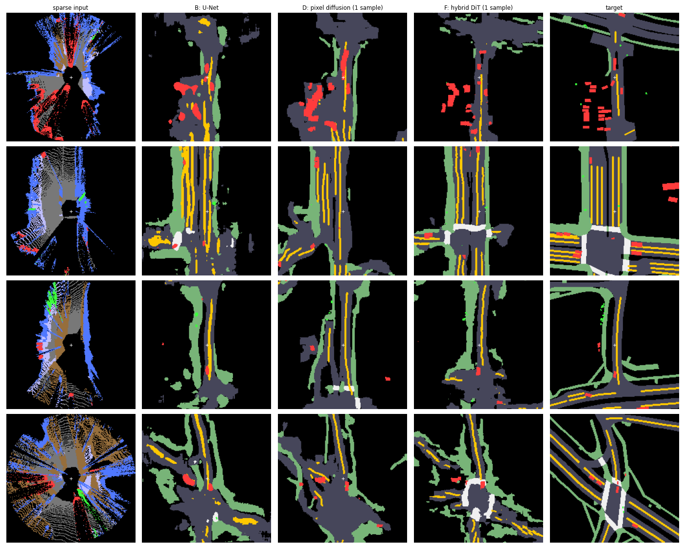

# Dreaming of Birds

Predict the full bird's-eye-view (BEV) map (drivable area, pedestrian crossings, walkways, lane dividers, vehicles, pedestrians) from the 6 surround cameras of a nuScenes car, and test whether diffusion models can "dream" the dense map from sparse, noisy projected evidence.

**Headline (nuScenes trainval, 10.6k training frames):** a diffusion transformer that cross-attends to the camera images (hybrid DiT) reaches test mIoU **0.319** vs **0.260** for a U-Net. It wins on road layout (map mIoU 0.422 vs 0.316) and loses on objects (0.114 vs 0.148). Full log: [EXPERIMENTS.md](EXPERIMENTS.md).

## Pipeline



## Geometry

- Pixel (u, v) with depth d unprojects through the camera intrinsics K: `p_cam = d * K^-1 [u, v, 1]^T`, then the camera-to-ego calibration (4x4) moves it into the ego frame (single keyframe; the few-ms camera/lidar timestamp offset is ignored).
- Ego frame: x forward, y left, z up. BEV image: row 0 is the far-forward edge, col 0 is the left edge, so forward points up.
- `row = (x_max - x) / res`, `col = (y_max - y) / res`; 200x200 cells, 0.5 m/cell, +-50 m, ego at the centre.
- Targets are 6 independent (multi-label) layers: drivable area, ped crossing, walkway, lane dividers from the nuScenes map expansion, rasterised around the ego pose; vehicle and pedestrian from 3D boxes in the same ego frame (boxes with 0 lidar+radar points are skipped).

## Models

| ID | Model | One line |
|---|---|---|
| A | Projection only | Label a cell by the projected camera label (road to drivable, sidewalk to walkway, ...). |
| B | U-Net | 1.9M params, 4 levels (32-64-128-256), 6 sparse channels in, 6 logit layers out; pos-weighted BCE + soft Dice. |
| D | Pixel diffusion | From-scratch conditional diffusion (cosine schedule, 20-step DDIM), same U-Net backbone (2.1M); input = noisy map + sparse BEV, predicts x0 logits. |
| F | Hybrid DiT | 45.6M-param diffusion transformer over 8x8 BEV patches (625 tokens). Each of 12 blocks: self-attention, cross-attention to 672 camera tokens (frozen DINOv2-small patches + MLP of the patch's ray in the ego frame + camera-id embedding), MLP; timestep via adaLN-Zero. |

D and F share the schedule, loss and sampler (`models/pixel_diffusion.py`), so D vs F isolates the network and the camera tokens.

## Results

Test = official nuScenes val scenes (1,982 frames); model selection on a held-out 8% of train scenes (919 frames); train 10,628 frames. Per-layer IoU at threshold 0.5, single seed.

| Method | drivable | ped crossing | walkway | divider | vehicle | pedestrian | map mIoU | obj mIoU | mIoU |
|---|---|---|---|---|---|---|---|---|---|
| A: projection only | 0.204 | 0.000 | 0.075 | 0.000 | 0.059 | 0.005 | 0.070 | 0.032 | 0.057 |
| B: U-Net | 0.591 | 0.155 | 0.302 | 0.218 | **0.232** | **0.064** | 0.316 | **0.148** | 0.260 |
| D: pixel diffusion (4-sample mean) | 0.528 | 0.063 | 0.188 | 0.109 | 0.161 | 0.015 | 0.222 | 0.088 | 0.177 |
| F: hybrid DiT (1 sample) | 0.672 | 0.334 | 0.377 | 0.250 | 0.189 | 0.035 | 0.408 | 0.112 | 0.310 |
| F: hybrid DiT (4-sample mean) | **0.690** | **0.341** | **0.401** | **0.256** | 0.203 | 0.025 | **0.422** | 0.114 | **0.319** |



Colours: dark grey = drivable, white = crossing, green = walkway, yellow = divider, red = vehicle, bright green = pedestrian. The DiT draws intersections and crossings that the sparse input barely shows; its cars are crisp boxes, but misplaced ones cost more IoU than the U-Net's blobs.

**Ablations** (DiT with one input removed, 4-sample mean, test):

| Variant | map mIoU | obj mIoU | mIoU |
|---|---|---|---|
| B: U-Net (sparse only) | 0.316 | 0.148 | 0.260 |
| F full (sparse + cameras) | **0.422** | 0.114 | **0.319** |
| F without cameras (sparse only) | 0.331 | 0.113 | 0.258 |
| F without sparse (cameras only) | 0.409 | 0.089 | 0.302 |

## What I learned

- **Monocular depth smears objects along camera rays.** Projection alone gives streaks, not boxes (model A), and dilating them did not help.
- **ControlNet memorised instead of learning geometry.** On nuScenes-mini (282 frames) a Stable Diffusion 1.5 ControlNet drew crisp, realistic cars in the wrong places (vehicle IoU 0.49 on train frames vs 0.002 on test). Stable Diffusion's schedule also has non-zero terminal SNR, so sampling from pure noise failed until I started from a noised blank map.
- **Concat-conditioned pixel diffusion never beat the U-Net**, with the same backbone and loss, on 282 frames and on 38x more data: most training steps sit at low noise where the noisy map leaks the answer.
- **The cameras give the map gain.** Without them the DiT equals the U-Net (0.258 vs 0.260); cameras alone already reach 0.302. The sparse projection mainly helps place objects (obj 0.089 to 0.114).
- **Per-cell IoU prefers hedged blobs over sharp misplaced boxes**, which is why objects stay best with the plain U-Net.
- **Data is the bottleneck for small models:** 38x more data lifted the U-Net's vehicle IoU from 0.151 to 0.232.

## Reproduce

```bash
pip install -r requirements.txt      # needs a CUDA GPU; depth+seg run in fp16 (~2 GB VRAM)
```

Data goes under `~/datasets/` (paths and the `dataset: mini | trainval` switch are in `config.yaml`):
- Mini (~4 GB): `wget https://www.nuscenes.org/data/v1.0-mini.tgz`, extract to `~/datasets/nuscenes` (`sweeps/` not needed).
- Trainval: from https://www.nuscenes.org/nuscenes#download get `v1.0-trainval_meta.tgz` plus `v1.0-trainval0{1..4}_blobs_camera.tgz`; extract the meta and only `samples/` of each blob to `~/datasets/nuscenes_trainval` (`tar -xzf <blob> --wildcards 'samples/*'`).
- Map expansion v1.3: extract into the dataroot's `maps/`.

```bash
./run_pipeline.sh                            # every step below plus both ablations, logs RAM/disk per step to logs/

python prepare_data.py                       # depth + seg -> 6-ch sparse BEV + box layers
python make_map_targets.py                   # adds map layers -> 6-layer target (CPU)
python train.py                              # B: U-Net
python train_pixel_diffusion.py              # D: pixel diffusion
python extract_image_features.py             # frozen DINOv2 camera tokens for F
python train_dit.py                          # F: hybrid DiT
python evaluate.py                           # test metrics + qualitative.png in results/
python train_dit.py --ablation no_cams       # or no_sparse; checkpoints in checkpoints/dit_<name>
python evaluate.py --ablation no_cams        # DiT rows only, results in results/ablation_<name>/
python visualize_sample.py <sample_token> out.png   # 6 cameras + sparse + target
```

## Repo layout

- `config.yaml` - all paths and hyperparameters, dataset switch
- `bev_geometry.py` - BEV convention, projection and rasterisation helpers
- `prepare_data.py`, `make_map_targets.py`, `extract_image_features.py` - build the sparse input, targets and camera tokens
- `dataset.py` - cached BEV dataset, scene-based splits
- `models/` - `unet.py` (B), `pixel_diffusion.py` (schedule, loss, DDIM; D and F), `dit.py` (F, `apply_ablation`)
- `train.py`, `train_pixel_diffusion.py`, `train_dit.py` - training for B, D, F
- `evaluate.py`, `metrics.py` - test metrics, qualitative figure
- `visualize_sample.py`, `viz.py` - plotting helpers
- `run_pipeline.sh` - the whole pipeline in order
- `results/` - result tables and figures; `EXPERIMENTS.md` - experiment log (E0-E10); the earlier objects-only ControlNet/refiner code is in git history at b5afca6
